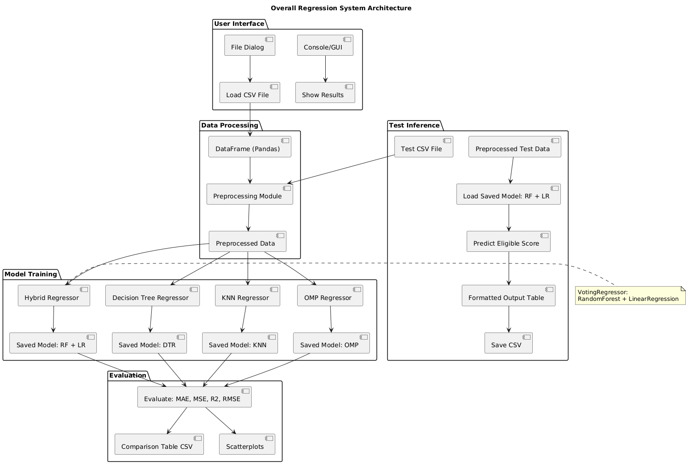

# Capability Profiling and Optimization for Vehicle On-Board Units

A machine learning web app that predicts the communication capability ("Eligible" score) of vehicle on-board units (OBUs) from their hardware and network parameters. Group major project (B.Tech, CSE-AI&ML).

## Features
- Upload a CSV dataset and explore it with EDA plots
- Train and compare 4 regression models:
  - Decision Tree Regressor
  - Orthogonal Matching Pursuit
  - K-Nearest Neighbors
  - Hybrid: Random Forest + Linear Regression
- Compare models using MAE, MSE, RMSE and R² score
- Predict for a single vehicle or for a whole CSV file

## Dataset
About 18,700 records with these columns: RAM, storage, Trustfactor, Distance, TransmissionRate, and the target `Eligible`. A small `TestData.csv` is included for prediction.

## Tech stack
Python, Flask, pandas, NumPy, scikit-learn, Matplotlib, Seaborn, HTML/CSS/JavaScript

## How to run
```
pip install -r requirements.txt
python app.py
```
Then open http://localhost:5000 in your browser, upload the dataset CSV, and train the models.

## Project files
- `app.py` – Flask web app
- `ml_utils.py` – data processing, model training and prediction
- `VOCC.ipynb` – notebook version of the project
- `templates/`, `static/` – web pages, CSS and JavaScript
- `Images/` – system design diagrams (UML, architecture)

## System design



## My role
This was a group project (4 members). I prepared the project report and the presentation, and worked on running and comparing the 4 regression models (Decision Tree, OMP, KNN and Random Forest + Linear Regression). The base code and dataset were provided by our project guide.
